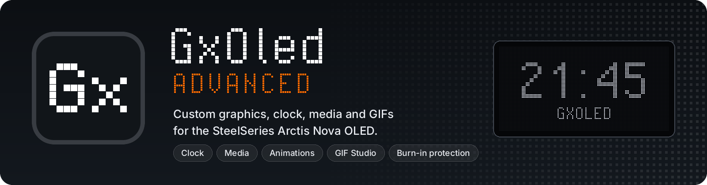
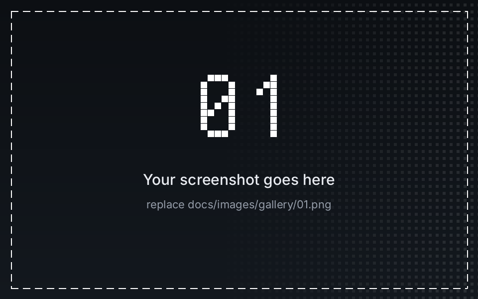
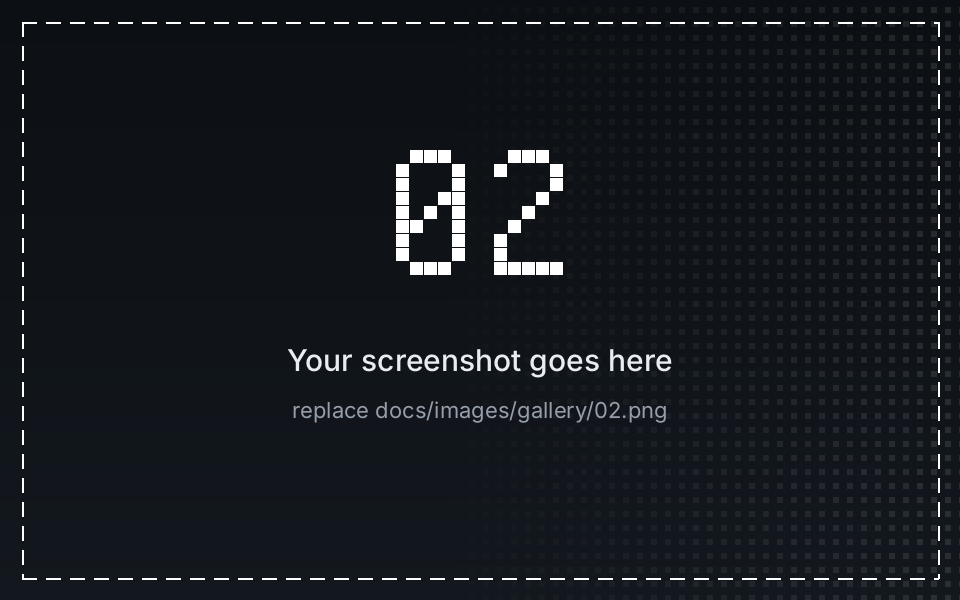
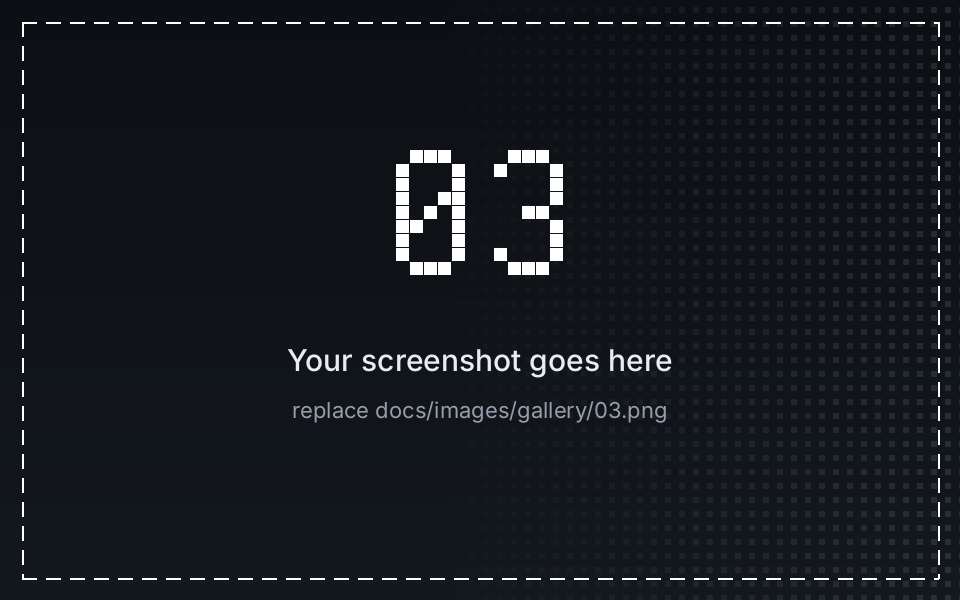
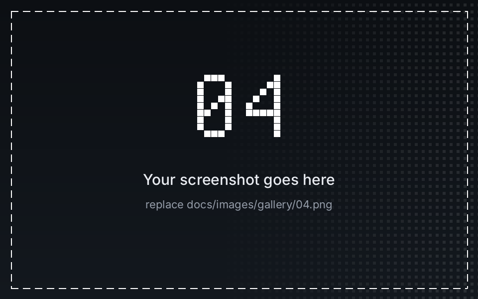
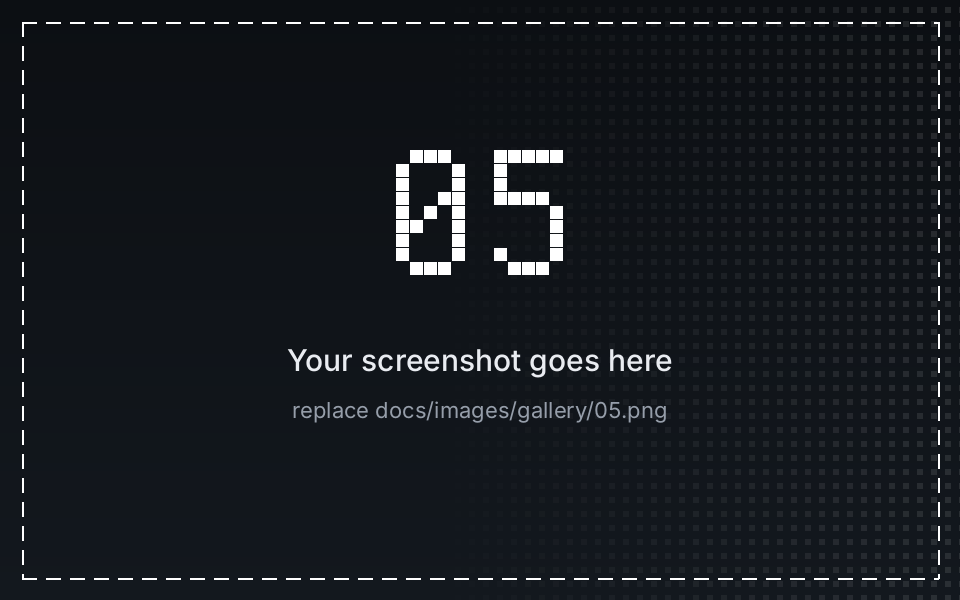
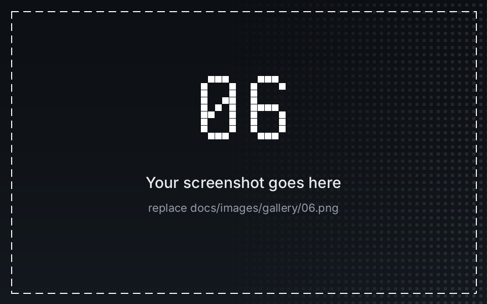
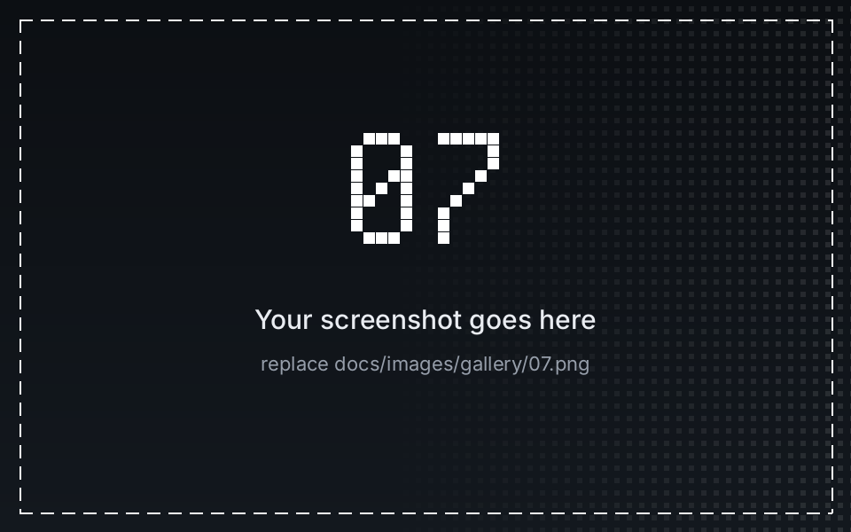
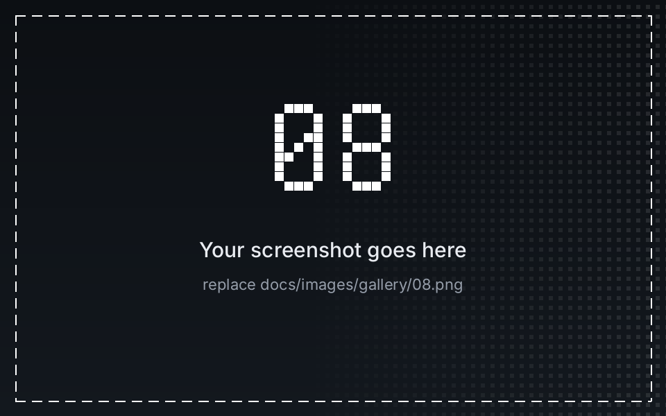
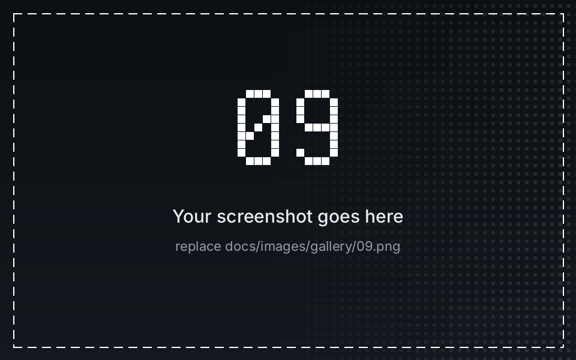

<h1 align="center">
  
</h1>

<p align="center">
  <b>An unofficial OLED control panel for compatible SteelSeries base stations.</b><br>
  Clock styles, burn-in mitigation, SteelClock-Go animations, a GIF editor, brightness controls and a native Windows settings window — built on <a href="https://github.com/JerwuQu/ggoled">JerwuQu/ggoled</a>.
</p>

<p align="center">
  <a href="https://github.com/MehmetNY/GxOled-Steelseries-Oled-Control-Panel/releases/tag/v0.6.2"></a>
  
  <a href="LICENSE"></a>
  
</p>

<p align="center">
  <a href="https://github.com/MehmetNY/GxOled-Steelseries-Oled-Control-Panel/releases/tag/v0.6.2"><b>Download v0.6.2</b></a>
  &nbsp;·&nbsp; <a href="#new-in-this-release">New</a>
  &nbsp;·&nbsp; <a href="#features">Features</a>
  &nbsp;·&nbsp; <a href="#gallery">Gallery</a>
  &nbsp;·&nbsp; <a href="#get-started">Get started</a>
  &nbsp;·&nbsp; <a href="#developers--ai-agents">Developers &amp; AI agents</a>
  &nbsp;·&nbsp; <a href="#changelogs">Changelogs</a>
</p>

<p align="center">
  <br>
  <sub>The settings window (classic layout, a screenshot from an earlier version). The modern interface has been the default since v0.5.3.</sub>
</p>

## New in this release

**v0.6.2** — a new logo and icon set, GIFs and animations at their real speed, a burn-in fix for the big clocks and a deep bug audit.

- **New logo and icons** — a pixel "Gx" mark. **Black** means GxOled is running; the **red** tray icon means *no base station (DAC) is connected*, so the OLED is not being driven.
- **GIFs and animations play at their real speed** on the OLED (their frame times used to be rounded up to the 33 ms render tick).
- **"No overlapping Pixels" now moves the big clocks** (round / square analog, Digital Big) instead of leaving them in the middle.
- **A stopped Go animation helper is noticed**, restarted and explained instead of leaving a blank screen.
- **Safer settings and start-up** — an unreadable `config.toml` is kept as `config.toml.bad`; tray clicks made before the base station connects are replayed; the *Start with Windows* entry is repaired after an update.
- **Windows polish** — a minimised settings window stops using resources, the header shows the real model and the connection state, the tray icon disappears when you quit.
- **Turkish letters ş ğ İ** are drawn correctly in OLED text.
- **Redesigned README and short release notes** — every detail is written once, in [`CHANGELOG.md`](CHANGELOG.md), and shown per version under [Changelogs](#changelogs).

Compiled and unit-tested in CI; **not verified on a physical base station**. What the audit found and left open: [`docs/KNOWN-ISSUES.md`](docs/KNOWN-ISSUES.md).

## Features

- **Clock gallery** — digital standard/large, round/square analog, and Casio-inspired digital dial; a live 128 × 64 OLED preview.
- **OLED burn-in mitigation** — an independent screen shifter plus clock-specific **Random Movements** and **No overlapping Pixels** modes. These distribute static pixel usage; they **do not guarantee** that burn-in cannot occur.
- **SteelClock-Go animations** — **Matrix Rain**, **Hyperspace**, **Star Wars Intro**, and **Game of Life**, including editable/importable/exportable 128 × 64 JSON profiles. The original Go renderer runs as a supervised helper; GxOled retains control of the USB/OLED connection.
- **GIF Studio** — edit a GIF for the OLED: fit/rotate/mirror/zoom/shift, background, brightness/contrast/gamma/threshold/auto levels, Floyd–Steinberg, Atkinson, ordered, threshold or no dithering, speed, minimum frame time, trim and loop, with live source and OLED-result previews. Play it on the base station, save the settings as a project, export the result as a two-colour GIF. Processing model after [GGIF-Studio](https://github.com/D4rkTT/GGIF-Studio) (MIT); layers, text and a timeline are not included yet. Details: [`docs/GIF-STUDIO.md`](docs/GIF-STUDIO.md).
- **Display & daily controls** — device brightness levels 1–10, idle screensaver/stock display behavior, native volume overlay cooperation with a selectable hold time (**Display → Volume screen time**, 1–5 s, default 2.5 s), and optional media information.
- **Native Windows settings** — modern interface (default) or the classic window in the same EXE, dark/light, English/Türkçe, Tray/Window/Hybrid modes, optional Windows startup, and saved preferences ([`docs/MODERN-UI.md`](docs/MODERN-UI.md)).
- **At a glance in the tray** — the tray icon is the black "Gx" while a base station is connected and turns red when none is found; its tooltip says so in words.

## Gallery

<!--
  3 x 3 gallery. Every picture is docs/images/gallery/NN.png (01 ... 09, left to right, top to bottom).
  They are placeholders until replaced: save your own PNG under the same name, no edit of this file is needed.
  Instructions: docs/images/gallery/README.md
-->
<table>
  <tr>
    <td align="center"><a href="docs/images/gallery/01.png"></a></td>
    <td align="center"><a href="docs/images/gallery/02.png"></a></td>
    <td align="center"><a href="docs/images/gallery/03.png"></a></td>
  </tr>
  <tr>
    <td align="center"><a href="docs/images/gallery/04.png"></a></td>
    <td align="center"><a href="docs/images/gallery/05.png"></a></td>
    <td align="center"><a href="docs/images/gallery/06.png"></a></td>
  </tr>
  <tr>
    <td align="center"><a href="docs/images/gallery/07.png"></a></td>
    <td align="center"><a href="docs/images/gallery/08.png"></a></td>
    <td align="center"><a href="docs/images/gallery/09.png"></a></td>
  </tr>
</table>

## Get started

1. Download [**`GxOled.Advanced.v0.6.2.exe`**](https://github.com/MehmetNY/GxOled-Steelseries-Oled-Control-Panel/releases/download/v0.6.2/GxOled.Advanced.v0.6.2.exe) from the [v0.6.2 release](https://github.com/MehmetNY/GxOled-Steelseries-Oled-Control-Panel/releases/tag/v0.6.2). To verify it, compare its SHA-256 with `SHA256SUMS.txt` (next to the download, `sha256sum -c SHA256SUMS.txt` does it).
2. Connect a supported **SteelSeries base station** over USB and run GxOled.
3. Open **Settings** (using the tray icon or the configured window mode). Select **Clock**, **Animations**, **GIF Studio**, or **Display**.
4. Use **Display → Clock burn-in protection** for clock movement, and **Display → OLED screen shift** for whole-screen shifting.
5. **Display → Volume screen time** sets how long the base station's own volume screen stays after you turn the knob before GxOled returns (1, 1.5, 2, 2.5, 3, 4 or 5 s). Background: [`docs/VOLUME_OSD_HANDOFF.md`](docs/VOLUME_OSD_HANDOFF.md).

**Compatibility:** the code identifies Arctis Nova Pro **Wired** (`12CB`, `12CD`) and **Wireless** (`12E0`, `12E5`, `225D`) base stations. Nova Elite (`2244`) is experimental and not hardware-verified here. These IDs are USB **product IDs**, not a promise of universal SteelSeries compatibility. Windows is the primary tested desktop target; Linux/macOS sources exist but are not equivalent to a verified Windows release.

**Türkçe kısa bilgi:** Saat, GIF ve animasyon seçeneklerini Windows ayar penceresinden yönetebilirsiniz. Tepsi simgesi **siyah** ise uygulama çalışıyor ve baz istasyonu bağlıdır; **kırmızı** ise baz istasyonu (DAC) bağlı değildir ve OLED ekran sürülmüyordur. Yanık izi koruması riski azaltır, tamamen ortadan kaldırmaz. Her sürümün ayrıntılı değişiklik listesi en altta **Changelogs** başlığındadır; bilinen sorunlar [`docs/KNOWN-ISSUES.md`](docs/KNOWN-ISSUES.md) dosyasındadır.

## Developers & AI agents

The sections below are intentionally collapsed for everyday users. They are **source-oriented tutorials**, not promises that unreleased features already work. Development contributions are welcome; protect the stable UI and review changes against the actual device protocol. Documentation index: [`docs/README.md`](docs/README.md).

<details>
<summary><strong>1. Architecture, module map and single-owner OLED pipeline</strong></summary>

GxOled combines a Rust device backend, an SDL3/tray application, native Win32 settings windows, and an embedded Go animation process:

| Location | Purpose |
|---|---|
| `gxoled_lib/src/` | HID discovery, USB product IDs (`SUPPORTED_PRODUCT_IDS`), report packing and device I/O |
| `gxoled_draw/src/` | One-bit frame composition on a 30 fps render thread, clocks, text, OLED screen shifting, animation layers (also the simple GIF decoder the CLI uses) |
| `gxoled_draw/src/casio.rs` | Casio-inspired 128 × 64 clock rendering |
| `gxoled_studio/src/` | GIF Studio engine: settings, decoding with limits, fit/rotate/zoom, tone and dither, playback plan, GIF export, project files — no OS dependency, see [`docs/GIF-STUDIO.md`](docs/GIF-STUDIO.md) |
| `gxoled_ui/` | Modern settings toolkit: layout, SVG scene rasterised by `resvg`, embedded Inter fonts and Lucide icons, interaction state machine — no OS dependency |
| `gxoled_app/src/main.rs` | Settings/configuration, tray events, clocks and animation state |
| `gxoled_app/src/settings_window.rs` | **Classic** native Windows settings UI — preserve its layout; it stays selectable and is the automatic fallback |
| `gxoled_app/src/modern_window.rs`, `modern_ui.rs`, `settings_ui.rs` | Modern settings interface (Win32 host, bridge, style switch) — see [`docs/MODERN-UI.md`](docs/MODERN-UI.md) |
| `gxoled_app/src/go_bridge.rs` | Starts and supervises the Go helper and consumes raw monochrome frames |
| `go_animations/internal/widget/` | Four upstream-derived SteelClock-Go animation implementations |
| `go_animations/cmd/renderer/` | Headless Go process and embedded default animation profiles |
| `gxoled_cli/src/main.rs` | Standalone command-line controls |
| `assets/branding/`, `gxoled_app/assets/`, `tools/make_branding.py` | Logo and icon masters, the icons the EXE embeds, and the generator — see [`docs/BRANDING.md`](docs/BRANDING.md) |
| `tools/sync_readme_changelog.py`, `release-notes/` | Builds the *Changelogs* section below from `CHANGELOG.md`; the short text that becomes each GitHub release body |
| `.github/workflows/` | `build.yml` (tests, Go helper, README check, Windows / MinGW / Flatpak builds) and `release.yml` (publishes a release when a `release/v<version>-advanced` branch is pushed) |

**Frame ownership:** Go renders `128 × 64` single-bit frames (1,024 bytes, MSB-first). Rust receives those frames and is the **only component** that writes to the base station via USB/HID. The Go helper does not contact the device or GameSense. Do not add a second simultaneous OLED writer.

**Third-party provenance:** the app is derived from [JerwuQu/ggoled](https://github.com/JerwuQu/ggoled); the four Go widgets and supporting code derive from [pozitronik/steelclock-go](https://github.com/pozitronik/steelclock-go) (see [`go_animations/UPSTREAM.md`](go_animations/UPSTREAM.md)). GIF Studio is an independent Rust reimplementation of the processing model of [D4rkTT/GGIF-Studio](https://github.com/D4rkTT/GGIF-Studio) (MIT), not a bundled Electron UI. Licences and notices: [`THIRD_PARTY_NOTICES.md`](THIRD_PARTY_NOTICES.md). Preserve licenses and attribution.

</details>

<details>
<summary><strong>2. Build and test on Windows (Rust + optional Go)</strong></summary>

Prerequisites: current Rust toolchain with `cargo` (Rust 1.88 or newer), Visual Studio C++ build tools, and CMake/SDL3 build requirements. Use a **short checkout path** such as `C:\gx` to avoid deeply nested Windows/CMake paths. Build from the repository root:

```powershell
cargo check --locked -p gxoled_app --features sdl3-static
cargo test --locked -p gxoled_app -p gxoled_lib -p gxoled_draw -p gxoled_studio -p gxoled_ui --features gxoled_app/sdl3-static
cargo build --locked --release -p gxoled_app --features sdl3-static
```

The desktop executable is `target\release\gxoled.exe`, **not** automatically `release\gxoled.exe`. On Windows you can also invoke `Validate-Windows.cmd` for check → tests → build (the same crates as CI). The CLI can be built separately:

```powershell
cargo build --locked --release -p gxoled_cli
```

On Linux no device is needed for the tests: `cargo test --locked -p gxoled_lib -p gxoled_draw -p gxoled_studio -p gxoled_ui`; the `gxoled_app` tests run there too with `--features gxoled_app/sdl3-static` (it builds SDL3 and needs `cmake` and the X11 development packages). The Windows-only code is compiled only on Windows.

**Go renderer:** `go_animations/gxoled-animations.exe` is embedded at compile time using `include_bytes!`. The source contains this helper; do not delete it as “build junk”. When changing Go widget code, regenerate it **before** building the Rust app:

```powershell
cd go_animations
go vet ./...
go test ./...
go build -trimpath -ldflags="-s -w" -o gxoled-animations.exe ./cmd/renderer
cd ..
cargo build --locked --release -p gxoled_app --features sdl3-static
```

Go 1.23+ is required by `go_animations/go.mod` when rebuilding the helper. CI (job *Go animation helper*) runs `go vet`, `go test` and checks that the two copies of the built-in profiles are identical; it does **not** rebuild the committed EXE, so rebuild and test it yourself before committing a new one. A successful compile does **not** validate physical OLED hardware.

**Python helpers** (standard library only, except Pillow for the branding script): `python3 tools/sync_readme_changelog.py --check` and `python3 -m unittest discover -s tools` run in CI as well.

</details>

<details>
<summary><strong>3. Animation profiles — JSON tutorial and validation rules</strong></summary>

The built-in presets are in [`go_animations/profiles/128x64/`](go_animations/profiles/128x64/) and the embedded renderer copies are in [`go_animations/cmd/renderer/profiles/`](go_animations/cmd/renderer/profiles/). Supported widget types: `matrix`, `hyperspace`, `starwars_intro`, `game_of_life`.

To make a custom animation profile in the Windows interface:

1. Open **Animations**, choose one of the four engines and select **New Profile**, **Import** or **Edit**.
2. For a new profile, use **Reset** in the JSON editor to populate a valid default template.
3. Change settings for that widget only; save/apply the configuration and select the profile.
4. Export the profile before experimenting with complex changes.

The validator expects exactly **one widget**, display dimensions **128 × 64**, `refresh_rate_ms` from **10 to 1000**, and a type compatible with the selected engine. The profile is limited to **64 KiB**. It does **not** check the widget's own numbers: zero sizes or huge counts can crash or hang the helper. GxOled notices a helper that stops (it restarts it and, after three quick stops, returns to the clock and shows the helper's error line); a helper that stays alive but silent is not detected — see [`docs/KNOWN-ISSUES.md`](docs/KNOWN-ISSUES.md). Start from the complete [Matrix JSON profile](go_animations/profiles/128x64/matrix.json) rather than inventing required nested fields.

Custom profiles are stored in `%APPDATA%\GxOled\profiles\custom\` on typical Windows installations. Only files whose name (with `.json`) has at most 120 characters, all from `A–Z a–z 0–9 . _ -`, and whose content passes the validator are listed; any other file in that folder is ignored without a message.

Preserve both profile-copy locations when you edit built-in defaults; `//go:embed` compiles the renderer's copies into its EXE. Test with `cd go_animations; go test ./...` and then rebuild the helper.

</details>

<details>
<summary><strong>4. Burn-in controls, GIF playback and configuration behavior</strong></summary>

**Two separate shift mechanisms:**

- **OLED screen shift:** Off/Low/High applies a small translation during frame composition. The drawing module advances this on a roughly **90-second** cycle.
- **Clock burn-in protection:** Off / **Random Movements** / **No overlapping Pixels** selects clock placement strategies, normally updated at minute boundaries. The second mode aims to reduce consecutive clock pixel overlap by moving the clock to a position at least 12 px clear of the previous one; when the clock is too large for that (the analog clocks, Digital Big), it takes the position furthest from the previous one. The Casio-inspired full-screen clock does not use the clock-specific repositioning, although the independent OLED shifter can still apply.

OLED protection **reduces risk**, not panel wear. Avoid leaving static imagery at high brightness indefinitely.

**GIF Studio** (since v0.6.0): a single-GIF editor (crate `gxoled_studio`, page in `gxoled_ui`) with live previews, playback on the OLED, GIF export and project files — see [`docs/GIF-STUDIO.md`](docs/GIF-STUDIO.md). It is not a layer editor, text/video editor or draggable timeline. Keep development claims separate from release claims. The application bounds image size, frame count and decoded pixels for safety. The settings window, the classic window and the tray menu play GIFs through `gxoled_studio`; the **CLI** (`gxoled-cli anim`) uses its own simple decoder in `gxoled_draw::decode_frames`, without the Studio limits.

**Configuration:** on Windows settings normally reside at `%APPDATA%\GxOled\config.toml` and are persisted between launches; a file that cannot be read is kept as `config.toml.bad` before fresh settings replace it. Keep backwards compatibility for existing serialized enum variants and stored paths. Windows startup registration belongs to the current user rather than a system-wide installation. Device brightness uses protocol steps 1–10 (both windows show them as 10 % … 100 %); they are steps of the base station, not calibrated luminance.

</details>

<details>
<summary><strong>5. AI agent / contributor checklist — keep the classic window intact</strong></summary>

1. Read this README, [`CHANGELOG.md`](CHANGELOG.md), the [documentation index](docs/README.md) and [`go_animations/UPSTREAM.md`](go_animations/UPSTREAM.md), then the target module. Establish what the **current release** really contains (changelog, GitHub Releases) before changing documentation; `stable` on the Releases page is the older *GxOled Light* v0.4.0 build.
2. Tags and release branches are immutable references: never delete, retag or force-push them (the release workflow refuses an existing tag). Keep experiments on a separate feature branch. **Do not edit or redesign** the classic Windows settings window merely to add a feature (the modern interface is in `gxoled_ui` and `modern_*.rs`).
3. The classic window uses **GENERAL CONTROL**, **CLOCK GALLERY**, and **LIVE OLED / MONOCHROME**; it is not the experimental card-grid **OLED CONTROL CENTER** layout. The reference screenshot is [`docs/images/gxoled-advanced-main.png`](docs/images/gxoled-advanced-main.png).
4. Preserve the Rust HID ownership model, 128 × 64 output dimensions, configuration compatibility, and licensing notices. Do not remove `go_animations/gxoled-animations.exe` while Rust embeds it.
5. For changes to display or animations, run the Rust checks/tests/build and the applicable Go tests. Manually validate Win32 controls, tray behavior, live preview, reconnect, GIF timing, and the base station when hardware is available.
6. Record validation honestly: **compiled**, **unit-tested**, and **verified on a physical base station** are different statuses. Prefer reproducible focused commits, explain UI deltas, and publish development previews separately from releases.
7. Write a change **once**: in `CHANGELOG.md`, with a "Verification status (be precise)" bullet. Then run `python3 tools/sync_readme_changelog.py` (it rewrites the *Changelogs* section below) and write the short `release-notes/vX.Y.Z.md`. CI fails when README and changelog differ.
8. Review security and dependency updates (`cargo audit` when installed). Do not import a whole Electron/GameSense client into the HID app without an explicit architectural decision, a license review and a testable integration path.

</details>

<details>
<summary><strong>6. Linux/CLI and alternative workflows</strong></summary>

The CLI remains available for direct commands:

```sh
gxoled-cli --help
gxoled-cli brightness 1
gxoled-cli text "Hello, World!"
gxoled-cli img image.png
gxoled-cli anim animation.gif
```

For direct USB permissions on Linux, review [`11-steelseries-arctis-nova.rules`](11-steelseries-arctis-nova.rules) (it covers all six supported product IDs and grants every local user access to the HID device). A Flatpak manifest and systemd user service are provided under [`flatpak/`](flatpak/) and [`gxoled.service`](gxoled.service), but they require platform-specific packaging and testing. A prebuilt Linux or macOS binary is not provided. The CLI is less hardened than the application (a few invalid arguments still end in a panic); see [`docs/KNOWN-ISSUES.md`](docs/KNOWN-ISSUES.md).

</details>

<details>
<summary><strong>7. Logo, gallery, changelog and release workflow</strong></summary>

- **Logo and icons:** [`docs/BRANDING.md`](docs/BRANDING.md) lists every file and the colour rule (black = running, red = no base station). `python3 tools/make_branding.py` re-creates the icons, the ICO, the banner and the social-preview picture from one description of the mark.
- **Gallery:** the nine slots are `docs/images/gallery/01.png … 09.png`; replace a file to fill a slot ([`docs/images/gallery/README.md`](docs/images/gallery/README.md)).
- **Changelog:** `CHANGELOG.md` is the only place where a change is written in full. The *Changelogs* section below is generated from it, one collapsed block per version, and must not be edited by hand.
- **Release page:** the GitHub release body is `release-notes/vX.Y.Z.md` — short descriptive headings only — plus one line with the commit, the SHA-256 and the verification status.
- **Making a release:** bump the version (`Cargo.toml`, the six workspace entries of `Cargo.lock`, the `GxOled Advanced vX.Y.Z` label in `settings_window.rs`), update the changelog, the release notes, the download links in this README and run the sync script; push the work branch and wait for the *Build* workflow; then push `release/vX.Y.Z-advanced`. Details and the rules for tags and branches: [`docs/BRANCHES-AND-RELEASES.md`](docs/BRANCHES-AND-RELEASES.md).
- **Known issues and what was never verified on hardware:** [`docs/KNOWN-ISSUES.md`](docs/KNOWN-ISSUES.md).

</details>

## Changelogs

One collapsed block per version, newest first. The blocks are generated from [`CHANGELOG.md`](CHANGELOG.md) by `tools/sync_readme_changelog.py` — edit the changelog, not this section. The GitHub release pages only carry short headings.

<!-- CHANGELOGS:START — generated from CHANGELOG.md by tools/sync_readme_changelog.py; do not edit by hand -->
<details>
<summary><b>v0.6.2</b> — new logo and icons, GIFs and animations at their real speed, burn-in mode fix, deep bug audit</summary>

- **New: logo and icons.** One mark for everything: a pixel "Gx" on the OLED's own dot grid, on a rounded tile, drawn from the owner's two designs. The **black** tile is the running application. The **red** tile is the tray icon while **no base station (DAC) is connected** — a reminder that the OLED panel is not being driven; the tray tooltip says the same in words (*GxOled - no base station (DAC) connected* / *GxOled - DAC / baz istasyonu bağlı değil*). Where it is used: the file icon of the EXE (nine sizes, 16 – 256 px), the tray, **both settings windows** (the classic window and the classic profile editor had no icon of their own until now), the sidebar and footer of the modern window, and the Flatpak (installed as its scalable SVG icon). Every size is drawn on whole pixels, so the dots stay sharp at 16 and 32 px. Sources: `assets/branding/gxoled-icon.svg` and `gxoled-icon-disconnected.svg`; `tools/make_branding.py` re-creates every icon, the ICO, the README banner and the social-preview picture; PNG exports in `docs/images/logo/`; notes in `docs/BRANDING.md`.
- **Changed: documentation and release notes.** The GitHub release page carries only short, descriptive headings (`release-notes/v0.6.2.md`); every detail lives here and, one collapsible block per version, under *Changelogs* in the README. The README was redesigned (banner with logo and name, main picture, 3 × 3 gallery, Changelogs); `tools/sync_readme_changelog.py` builds that section from this file and CI fails when the two differ. Documentation that contradicted the code was corrected (see *Documentation* below).
- **Fix — GIFs and animations played too slowly on the OLED.** The next frame was scheduled `delay` after the render tick that noticed the previous one, not after the previous frame was due. The render loop ticks every 33 ms, so every delay was rounded up to whole ticks: a 40 ms frame (25 fps) lasted 67 ms, a 50 ms frame 67 ms, and a 100 ms frame 133 ms. The GIF Studio previews and the exported file were right, so the OLED ran visibly slower than the preview. Frames are now counted from their due time; after a stall (the volume screen, a USB hiccup) the schedule restarts from "now", so there is still at most one frame per tick and no burst of catch-up frames. Changes in 10 s according to a tick-by-tick model of the render loop (unit-tested): 40 ms frames 150 → 249 (ideal 250), 50 ms frames 150 → 199 (ideal 200), 100 ms frames 75 → 99 (ideal 100). Frames shorter than a tick (10 ms) still show one per tick. Applies to the OLED, to the mirror in the settings window and to the device-free preview.
- **Fix — "No overlapping Pixels" did not move the big clocks.** The mode needs a position 12 px clear of the previous clock. The round and square analog clock (54 px) and **Digital Big** are too large to find one from a clock that stands in the middle — which is where the clock is when the mode is switched on or the clock style changes — so the search returned "no offset" and the clock stayed in the middle **every minute for ever**: no burn-in protection at all for those styles. It now takes the position furthest from the previous clock (the analog clock then alternates between the two edges) and from the second minute on has the full gap again. The standard digital clock, which has the room, behaves as before. New tests use the real sizes of the bundled font (52 × 10, 78 × 15, 105 × 18 px) and fail without the fix.
- **Fix — the Go animation helper is supervised.** A helper that stopped by itself (a profile it rejects, a crash, a virus scanner) was never noticed: the OLED stayed blank, no clock came back, and the main loop kept waking every 10 ms. GxOled now sees the stop, keeps the helper's first error line and starts it again (at most every 2 s). After three quick stops in a row — a run of 10 s or more counts as healthy — it returns to the clock with one explanation (English / Türkçe) that shows the helper's error line and points at the custom profile. A start that fails for a moment (a virus scanner holding the freshly written helper) is counted the same way instead of discarding the chosen animation at once.
- **Fix — events were lost while waiting for the base station.** Tray clicks that arrived before the first connection (autostart before the DAC enumerates) were dropped although the tray had already flipped its check mark: the menu and the settings disagreed and nothing was saved. They are now replayed in order once the device is there. Related corrections in the main loop: starting a GIF loads its frames first and only then touches the running layer (a missing file no longer stops a running Go animation); a stopped GIF does not replay stale frames or ignore sliders moved in the meantime; the GIF re-render swaps the layer in one step; choosing a Go profile unchecks *Start / Stop GIF* in the tray (it used to need two clicks); a GIF that was playing when the screen went idle is resumed when you return (it used to stay stopped); the decoded GIF is released while no base station is connected.
- **Fix — status icons.** One rule for the headset connected / disconnected icon in every place that draws it: no icon on the full-screen Casio clock and none over a GIF or Go animation. Switching to Casio or starting an animation removes an icon that was already there.
- **Fix — settings file.** A file that cannot be read (a typo in a hand edit, a half-written file) is copied to `config.toml.bad` before fresh settings replace it; it used to be overwritten without a trace. The settings of the upstream-branded app are migrated **only on the very first launch** (when there is no settings file at all), no longer whenever the file was unreadable. Out-of-range numbers in the GIF Studio part (`threshold = 300`, `rotate = -90`, `min_frame_ms = 5000`, negative trim values) are repaired instead of rejecting the whole file and silently resetting every setting; the minimum-frame-time range is now the slider's range (10 – 200 ms).
- **Fix — Windows start-up entry.** *Start with Windows* stayed "on" after an update or a move although the entry pointed at a deleted copy (release files carry the version in their name). An entry whose program no longer exists is repointed to the running copy; an entry that points at another copy that still exists is left alone. `--modern-ui` is no longer overruled by the marker of a failed earlier start.
- **Fix — windows.** A **minimised** settings window no longer counts as visible: the live mirror, the GIF Studio previews and the 10 ms loop stop and the pixel buffers are released (v0.6.1 claimed this for hidden windows, but a minimised window is still "visible" to Windows); restoring a minimised classic window works; holding Enter / Space / Escape acts once instead of repeating (a held key on *Delete profile* removed one profile per repeat); the profile editor's text box keeps its I-beam cursor; choosing the already active window style no longer hides and re-opens the window, and after a failure of the modern window the classic one no longer opens next to a frozen modern one; the list of profiles is re-scrolled when it shrinks (deleting the last custom profile used to hide the first row); the modern header shows the **connection state** (the dot turns grey when the base station is unplugged) and the **real model name** (Wired, Xbox, White, Elite — it always said *Nova Pro Wireless* before); the Turkish header keeps its capitals (*STEELSERIES BASE STATION KONTROL MERKEZİ*, not *STEELSERİES BASE STATİON*); characters XML does not allow (for example in a file name) can no longer blank the whole window; "1 frames" became "1 frame".
- **Fix — texts and links.** The *GitHub* button of the About page opened the old v0.4.0 repository; it opens this project now. The tray no longer says "Show media alongside clock" (media replaces the clock, as both windows say) and the Turkish tray translates its sub-menu entries. *Screensaver when idle* said "dim and animate" but blanks the display after a minute without input; the caption now says that. The About page no longer lists MPL-2.0 for `resvg` (it is Apache-2.0 OR MIT). OLED text: **ş Ş ğ Ğ İ** are not in the bundled pixel font and were drawn as empty boxes in a media title such as "Şarkı" or "İstanbul"; they are now drawn as s S g G I (a custom font that has them keeps them).
- **Fix — quit.** Changes made in the last moments (the same pass as the *Quit* click, a slider still being applied) are saved; the tray icon is removed at once instead of lingering until the mouse passes over it; quitting with the base station unplugged no longer panics.
- **Fix — GIF Studio projects.** A `.gxgif.json` whose picture is on a network share (`\\host\share\x.gif`, `//host/share/…`) or a device path is refused with an explanation: opening it would make Windows try to sign in to that computer. Drive letters, mapped network drives and the long local form `\\?\C:\…` still work. The error message now includes its cause.
- **Build and release.**
  - `release.yml`: the version/branch guard applies to every trigger (a manual run from `main` can no longer publish); an existing **tag** (not only an existing release) stops the run, because deleting a release leaves its tag behind and `gh release create` would silently attach new binaries to the old commit; the release notes come from `release-notes/v<version>.md` plus one line (commit, SHA-256); the asset is named `GxOled.Advanced.v<version>.exe` (the name GitHub serves) and `SHA256SUMS.txt` has Unix line endings, so `sha256sum -c SHA256SUMS.txt` works next to the download; the checkout no longer keeps the write token in `.git/config` while dependency build scripts run.
  - `build.yml`: new job *Go animation helper* (`go vet`, `go test`, the two copies of the built-in profiles must be identical) — until now the Go code and the shipped helper were never built or tested in CI; the README *Changelogs* block must match this file.
  - The `image` crate is built without its default features: the AVIF encoder (`rav1e`, `ravif`) and a yanked crate it pulled in (`core2`) are no longer compiled into the Windows executable; the CLI still opens BMP, DDS, EXR, Farbfeld, GIF, HDR, ICO, JPEG, PNG, PNM, QOI, TGA, TIFF and WebP. The unused `anyhow` dependency of the CLI was removed.
  - `Validate-Windows.ps1` (and the test commands in the README and the Turkish build guide) now test `gxoled_studio` and `gxoled_ui` as CI does; the udev rules cover all six supported base station product IDs (`225d` and `2244` were missing); `.gitignore` no longer hides the embedded `go_animations/gxoled-animations.exe`.
- **Documentation.** `THIRD_PARTY_NOTICES.md` was rewritten from the real dependency list of the Windows build (140 crates by licence), the Inter files are described as the subsets they are (they were called "unmodified"), the missing entries (Go runtime BSD-3-Clause, Pixel Operator CC0, SDL, hidapi, the MPL-2.0 crate `option-ext`) were added and the licence texts that have to travel with a binary are reproduced inside the file that ships next to the EXE. `docs/MODERN-UI.md`, `docs/BRANCHES-AND-RELEASES.md`, `docs/GIF-STUDIO.md`, `docs/README.md`, the Turkish build guide and the README no longer describe GIF Studio as a future idea, no longer link a deleted release, no longer claim CI steps that do not exist, and agree on which releases are kept. New: `docs/BRANDING.md` and `docs/KNOWN-ISSUES.md`.
- **Known issues.** The audit found more than was fixed here; what remains is listed, with where to look, in `docs/KNOWN-ISSUES.md` — among others: the Go helper still crashes or hangs on some hand-edited profiles with extreme values (it is now noticed and switched off, but the profile validator does not check those ranges and the embedded helper is the build of v0.6.1); the classic window is not DPI-aware; GIF Studio's down-sampling of very large sources aliases thin lines; Casio 12-hour mode has no AM/PM marker.
- **Under the hood:** `gxoled_draw` schedules animation frames with `next_due`; `gxoled_lib` has one list of supported product IDs (`SUPPORTED_PRODUCT_IDS`) and `product_name`; `gxoled_app` has `clock_offset_in` (the clock placement search without a device), `clearest_of_previous`, `effective_status_notify` and a supervised `Runner` (`is_alive`, `diagnostic`); `gxoled_ui` has `logo_mark`. New unit tests: clock placement (7) and status icons (2), config-file and start-up-entry handling in `gxoled_app`; frame cadence and the glyph fallback in `gxoled_draw`; clamping of hand-edited numbers and project paths in `gxoled_studio`; product names in `gxoled_lib`; list scrolling and XML escaping in `gxoled_ui`.
- **Verification status (be precise):** compiled and unit-tested on Linux (`gxoled_app` 31, `gxoled_draw` 26, `gxoled_lib` 2, `gxoled_studio` 58, `gxoled_ui` 9 + 39 interaction tests), the Windows-only code (`cfg(windows)`) type-checked on Linux, and the Windows MSVC build and tests run in CI for the commit named in the release notes. The frame-rate figures come from the unit-tested model of the render loop, not from a measurement on a base station. **Not verified on a physical PC / base station:** how the new icons look in the tray, task bar, title bars and the Explorer (including 125 – 200 % scaling), the red tray icon and tooltip when the DAC is unplugged, GIF and animation speed on the real OLED, the supervised Go helper with a bad profile, the *Start with Windows* repair, the minimised-window behaviour, and the clock movement of the two fixed styles on the real panel.

</details>

<details>
<summary><b>v0.6.1</b> — GIF Studio preview play / pause, lower resource use while idle</summary>

- **New: play / pause button on the GIF Studio preview.** The *Preview* card has a small button in its header (same style as the other secondary buttons, icon + caption *Pause* / *Play*, *Duraklat* / *Oynat*). A GIF that is opened plays by itself in both previews (source and OLED result). The button freezes and resumes the **previews only**: *Start / Stop GIF* (what the base station and the *Live OLED* mirror show) is unchanged and independent.
- **Fix — the preview no longer runs when nobody looks at it.** Closing the settings window or selecting another page stops the preview clock and nothing is rendered for it (previously the editor previews were advanced every 40 ms even while the window was hidden). Coming back continues from the same frame; a pause pressed by the user stays a pause; opening another GIF starts it from the beginning, playing.
- **Lower resource use while the application sits in the tray** (no feature removed; the OLED output is bit-for-bit the same):
  - The main loop wakes every 50 ms (and exactly at each full second, for the OLED clock) instead of 100 times a second; it keeps the 10 ms rhythm while a settings window is open, a Go animation is running or a GIF re-render is pending.
  - The live-OLED mirror and the editor previews are computed only while a settings window is on screen.
  - When the modern window is hidden, its pixel buffers are freed (measured on Linux: 5.6 MiB in `Ui` + 2.6 MiB host copy at 1015 × 682, 12.2 + 5.9 MiB at 150 % DPI, 21.4 + 10.6 MiB at 200 %) and rebuilt in 13–20 ms when it is shown again.
  - A decoded GIF (about 40 MiB for 60 frames of 480 × 360, 88 MiB for 100 frames of 480 × 480) is dropped 10 s after its last use instead of 30 s, and as soon as the settings window goes away unless a re-render is still due. The frames that play on the OLED are separate and tiny (1 kB each); playback is not affected.
  - Windows: the working set is trimmed 5 s after start and after a settings window closes or a GIF is dropped, so Task Manager shows what the process actually needs while idle. This is *not* a reduction of allocated memory: pages that are touched again are faulted back in.
  - The OLED clock bitmap is drawn once per second instead of once per frame (30 ×); the editor's playback plan is computed once per settings change; the source thumbnail no longer copies the whole frame for every preview step (−0.65 MiB of allocation per step); the render thread's frame pacing uses the native sleep, which spins less on Windows.
- **Deliberately unchanged:** the 30 fps OLED render thread, the 480 px working size of GIFs (smaller would change the output), the SDL timer resolution, the per-second media polling and the Go renderer process (counted separately in Task Manager).
- **Verification status (be precise):** compiled and unit-tested on Linux, and the Windows-only code type-checked on Linux; the Windows MSVC build and tests run in CI for the commit. The figures above are measured on Linux with a counting allocator (heap bytes, not Task Manager numbers). **Not measured on Windows or on a physical PC / base station:** the real "Memory" figure in the Task Manager before and after, CPU usage, and the look and position of the new button on a real desktop.

</details>

<details>
<summary><b>v0.6.0</b> — GIF Studio: edit GIFs for the OLED, live previews, export and projects</summary>

- **New: GIF Studio editor** (modern settings window → *GIF Studio*). Open a GIF and tune how it becomes a 1-bit animation: *Fit* (contain / cover / stretch), rotation, horizontal/vertical mirror, zoom (0.2–3×), shift (±64 px), transparent-area background (black / white), invert source, auto levels, brightness, contrast, gamma, threshold, **five dither modes** (Floyd–Steinberg, Atkinson, ordered 4 × 4, threshold only, none), invert result, speed (0.1–5×), minimum frame time, first/last frame and loop / play once. Two previews animate in the page — the source picture and the 1-bit OLED result — while the right-hand *Live OLED* panel keeps showing only what the base station really shows. **Start / Stop GIF** plays the edited animation on the OLED (a playing GIF is re-rendered shortly after you stop moving a slider); **Export GIF…** writes it as a two-colour GIF; **Save project… / Open project…** keep the settings in a `*.gxgif.json` file. Details and ranges: `docs/GIF-STUDIO.md`.
- **Based on GGIF-Studio (MIT).** The option set and the tone/dither algorithm follow [GGIF-Studio](https://github.com/D4rkTT/GGIF-Studio) by Abdelnour Osman; this is an independent Rust reimplementation (no Node.js, Electron or GameSense; Rust is still the only OLED writer). Licence check: MIT, compatible with GPL-3.0; the notice is reproduced in `THIRD_PARTY_NOTICES.md`.
- **Changed — GIFs now play through the studio pipeline.** With the default settings a GIF is fitted to the 128 × 64 screen (previously it was drawn at its own size and cropped) and dithered with Floyd–Steinberg (previously a hard threshold). Choose *Tone & dither → Threshold only* for the crisp black/white look of earlier versions. The settings are stored in `config.toml` (`[animation_settings]`; old files get the defaults) and also apply when a GIF is started from the tray menu or the classic window.
- **Fix — the settings window opens smaller.** It opened at 1450 × 975 px on every screen; it now opens at about 70 % of that (1015 × 682 px, minimum 800 × 538) and is still shrunk to fit small monitors. The whole window keeps scaling proportionally when resized.
- **Fix — the OLED mirror obeys Start / Stop.** A GIF picked on the *GIF Studio* page played in the mirror by itself even when it was not running on the device. The mirror now shows a GIF only while it is playing (it appears on *Start* and disappears on *Stop*).
- **Under the hood:** new crate `gxoled_studio` (decoding, geometry, tone and dither, playback plan, GIF export, project files; no OS dependency; 48 unit tests); `gxoled_ui` gained generic sliders, the studio page and `studio_bind` (control ↔ setting mapping, unit-tested); `gxoled_draw` animation layers can play once and hold the last frame (`repeat`). A GIF that is neither playing nor open in the editor is dropped from memory after 30 s.
- **Not part of this release (planned):** several layers, text layers, a draggable timeline, undo/redo and video files (MP4/WebM would need a decoder such as ffmpeg).
- **Verification status (be precise):** compiled and unit-tested on Windows and Linux in CI for the commit named in the release notes (every dither mode, tone formula, rotation / mirror / fit / zoom / shift, background and inversion rules, playback timing, GIF export decoded back pixel for pixel, project and config round trips, every chip and slider of the page). **Not verified on a physical PC / base station:** the page on a real desktop (file dialogs, DPI changes, repaint cost of the two animated previews) and how each dither mode looks on the real OLED.

</details>

<details>
<summary><b>v0.5.3</b> — modern settings interface, live OLED mirror that shows the real screen, proportional window scaling</summary>

- **New: modern settings interface (default).** All seven pages (General, Clock, Animations, GIF Studio, Display, Media, About) and the animation-profile editor were redesigned: sidebar, cards, a live 128 × 64 OLED mirror, English/Türkçe, dark/light. The classic Win32 window is unchanged (its caption now reads *v0.5.3*) and still inside the same EXE; switch with the tray menu (*Settings window style*), *General → Settings window* in the modern window, the new *Modern UI* button in the classic window's left rail, or `gxoled.exe --classic-ui` / `--modern-ui`. The modern window falls back to the classic one automatically if it cannot be created, panics, or a previous start never painted. Details: `docs/MODERN-UI.md`.
- **Fix — the OLED mirror now shows the real screen.** Previously only the Casio clock (and Go animations) appeared in the mirror; the other four clock styles were drawn as plain text and GIFs not at all. The render thread now hands every frame it composes to the window, so the mirror shows exactly what is sent to the base station (all five clock styles, GIFs, media text, notifications, OLED pixel shift). Without a device frame (not connected, or the base station is showing its own volume screen) it shows the configured clock with the same drawing code, and on the *GIF Studio* page a picked GIF is previewed before it is started. The panel is titled *Live OLED* when the frames are real and *OLED preview* otherwise.
- **Fix — resizing no longer re-flows the window.** The modern window is always laid out for the same design width and the whole picture is scaled to the window (no lower/upper scale limit; minimum window 960 × 620). Cards, icons and captions keep their positions and proportions, so labels can no longer end up under toggles or two-column rows collapse into one.
- **Changed:** the header reads *SteelSeries Base Station Control Center* (was *SteelSeries DAC OLED control*). The General page's *Quick Access* card, which repeated the opening-mode choice, became a read-only **Settings Summary** (opening mode, language, appearance, start with Windows, what happens when GxOled closes).
- **Config:** optional key `ui_style` (`"Modern"` or `"Classic"`) in `config.toml`; files without it open Modern. Older GxOled versions ignore the key.
- **Under the hood:** new crate `gxoled_ui` (no OS dependency; SVG scene rasterised by the pure-Rust `resvg` with embedded fonts and icons), `modern_window.rs` (Win32 host), `modern_ui.rs` (bridge), `settings_ui.rs` (style switch); `gxoled_draw` gained a frame tap (`DrawDevice::latest_frame`), the shared clock composition and a device-free `GifPreview`. The earlier pre-releases `v0.5.3-beta` and `v0.5.3-beta.2` are superseded.
- **Third-party:** Inter fonts (SIL OFL 1.1), Lucide icons (ISC), `resvg`/`usvg`/`tiny-skia` and their dependencies (MIT / Apache-2.0 / BSD) — see `THIRD_PARTY_NOTICES.md` (shipped next to the EXE) and `gxoled_ui/licenses/`.
- **Verification status (be precise):** compiled and unit-tested on Windows and Linux in CI for the commit named in the release notes (layout invariance at every window size, every clock style, GIF preview timing, control-id table). **Not verified on a physical PC / base station:** how the windows behave on a real desktop (DPI changes, title-bar colouring, the editor's native text control, file dialogs) and the live mirror against a real device.
- **Not part of this release:** a custom title bar and the GIF editor inspired by GGIF-Studio (later phase; licence check first).

</details>

<details>
<summary><b>v0.5.3-beta.2</b> — beta fix: a way back to the modern interface from the classic window</summary>

> **Pre-release.** Stable stays at v0.5.2. This replaces the earlier pre-release `v0.5.3-beta` (kept, not deleted).

- **Fix:** after choosing *Classic* there was no control in the classic window to return to *Modern* — only the tray menu and `--modern-ui` could. The classic window now has a **Modern UI (Beta)** button in its left rail, visible on every page; it switches to the modern window at once and saves the choice. (Found by the owner while trying the way back.)
- The caption of the classic window reads *v0.5.3 Beta 2*; labels derived from the version handle `-beta.N` (`display_version_of` is unit-tested).
- Everything else is as in `v0.5.3-beta`: the modern interface is optional; switch styles from the tray menu (*Settings window style (Beta)*), from *General → Settings window (Beta)* in the modern window, from the new classic-rail button, or with `--classic-ui` / `--modern-ui`; automatic fall-back to Classic if the modern window fails; config key `ui_style`. Details: `docs/MODERN-UI.md` (the beta notes were merged into it); third-party licences: `THIRD_PARTY_NOTICES.md`.
- **Verification status (be precise):** compiled and unit-tested on Windows in CI for the commit named in the release notes. **Not verified on a physical Windows PC / base station:** the new classic-rail button's position and look (it is owner-drawn like the Quit button, placed above it), and everything listed as unverified under `v0.5.3-beta` (modern window behaviour, DPI changes, title-bar colouring, resizing, the profile editor's text control, repaint cost).

</details>

<details>
<summary><b>v0.5.3-beta</b> — modern settings interface (Beta, optional)</summary>

> **Pre-release for trying out a new look.** The stable line stays at v0.5.2 (`main`, `stable`, `v0.5.0`–`v0.5.2` are untouched). If you do not like the new interface, switch back in one click — see *Going back* below.

- **New (Beta): modern settings window.** All seven pages (General, Clock, Animations, GIF Studio, Display, Media, About) and the animation-profile editor were redesigned: sidebar navigation, card layout, a live 128 × 64 OLED panel, toggle/radio cards, a brightness slider, light and dark themes, English/Türkçe, per-monitor DPI scaling, resizable window. The window title bar is still the native Windows one (dark/light coloured through DWM on Windows 11).
- **Nothing was taken away.** The classic Win32 settings window is unchanged (only its version caption now reads *v0.5.3 Beta*) and is still compiled into the same EXE. Modern is the default in this beta; choose the style with
  - the tray menu → **Settings window style (Beta)** → *Modern (Beta)* / *Classic*, or
  - **General → Settings window (Beta)** inside the modern window (*Modern* / *Classic* chips), or
  - the command line: `gxoled.exe --classic-ui` (remembers Classic) / `--modern-ui`.
- **Automatic fall-back to Classic** if the modern window cannot be created, panics inside its window procedure, or a previous start did not reach its first painted frame (crash-guard marker `.modern-ui-pending` in `%APPDATA%\GxOled`). The choice is saved, so the next start opens the classic window.
- **How it is built:** new crate `gxoled_ui` (no OS dependency) draws each window as SVG with the pure-Rust `resvg` renderer and embedded fonts/icons; `gxoled_app/src/modern_window.rs` is a small Win32 host (HWND, input, DPI, DWM), `modern_ui.rs` maps the UI to the existing `MenuEvent`s with the same control ids as the classic window, `settings_ui.rs` chooses between the two. No browser, WebView, GPU or extra runtime is needed. Rust remains the only OLED writer.
- **Config:** new optional key `ui_style` (`"Modern"` or `"Classic"`) in `config.toml`; files without it open Modern in this beta. Older GxOled versions ignore the key.
- **Third-party:** Inter fonts (SIL OFL 1.1), Lucide icons (ISC), `resvg`/`usvg`/`tiny-skia` and their dependencies (MIT / Apache-2.0 / BSD) — see `THIRD_PARTY_NOTICES.md` and `gxoled_ui/licenses/`.
- **Verification status (be precise):** compiled and unit-tested on Windows in CI (see the release notes for the commit); the UI toolkit itself is unit-tested (interaction, layout, rendering to PNG in English/Turkish, dark/light). **Not yet verified on a physical Windows PC / base station:** window behaviour, DPI changes, title-bar colouring, resizing, the native text control of the profile editor, and the cost of repainting while hovering. Please report anything that looks wrong — and use Classic meanwhile.
- **Not part of this beta:** a custom title bar, and the GIF editor inspired by GGIF-Studio (later phase).

</details>

<details>
<summary><b>v0.5.2</b> — volume screen hand-back fixed, selectable volume-screen time</summary>

- **Fix:** after turning the DAC knob GxOled came back 4–6 s late instead of the intended 2.5 s. Measured cause (60 fps video aligned with a frame log, Nova Pro Wireless `12E5`): the base station discards every host frame for about 3.5 s after a dial report, so a frame written when the 2.5 s hold ended stayed invisible. GxOled now sends the documented `0x95` ("return to the SteelSeries UI") immediately before the first frame after the hold; that frame is accepted and the native screen is gone about 2.6 s after the last report. Details and limits: `docs/VOLUME_OSD_HANDOFF.md`.
- **New setting:** *Display → Volume screen time* (settings window) and *Volume screen time* (tray menu): 1, 1.5, 2, 2.5 (default), 3, 4 or 5 s, saved as `volume_osd_hold_ms` in `config.toml`. The duplicate-report filter follows the chosen time.
- Windows: a second GxOled instance is refused with a message instead of two copies fighting over the OLED.
- Windows build helper `Validate-Windows.cmd` builds in a short folder (avoids MSBuild path-length error FTK1011); repository docs reorganised under `docs/`.
- Verified on hardware by the owner with the 2.5 s default (camera test); the other times use the same mechanism but were not individually filmed.

</details>

<details>
<summary><b>v0.5.1</b> — DAC volume OSD handoff</summary>

- Keep the native DAC volume overlay in control for 2.5 seconds after a genuine dial change. Ignore short-interval repeated HID reports of the same level, which could rearm the timer and extend handoff toward 5–6 seconds.
- Preserve previously fixed clock/media layer cleanup, the existing settings UI geometry, and the embedded SteelClock-Go renderer.
- Add regression tests for duplicate dial reports, changing dial levels, and new dial actions after a quiet interval.
- Update the right-hand Windows settings label, the tray version label, and the Cargo workspace version to v0.5.1.
- Known issue (hardware-measured 2026-10-28, fixed in v0.5.2): the panel still returned to GxOled about 4–6 s after a dial turn, because the base station discards host frames for ~3.5 s; the hold was not the cause.

</details>

<details>
<summary><b>Earlier history</b> — notes from before the versioned <i>Advanced</i> releases</summary>

#### 2026-10-24 – Two-column settings recovery

- Restored a separate right-side OLED preview and About QR image instead of stacking them above the settings.
- Stabilized DPI scaling independently of window width and kept the navigation Quit action accessible on every page.
- Made animation profile directory notes wrap cleanly and prevented mouse-wheel-only brightness changes.
- Added explicit upstream credit to JerwuQu/ggoled and pozitronik/steelclock-go, with the donation note below the QR.
- Removed an unreachable duplicate localization branch for UI label 716.
- The historical UI notes have been consolidated into the README developer guide.

#### Settings layout recovery — 2026-10-24 (experimental)

- Removed the right-hand/hidden OLED preview breakpoint; preview now sits above the page content at every window width, with a single vertical scrolling content column.
- Preserved the non-reentrant Win32 layout/message locking fixes from the prior build.
- Removed broken Clock + Media overlay from the settings window and runtime renderer. Existing configs using that legacy option are migrated to exclusive media playback.
- Fixed Advanced Animation Editor multiline display by converting JSON LF line breaks to native Win32 CRLF; built-in and imported profiles are pretty-printed before editing and export.
- Replaced ten brightness radio buttons with a Windows trackbar (10%–100%, device steps 1–10) and a current-level label.
- Removed redundant second GitHub button. Publisher-provided QR asset is unchanged.
- Original SteelClock Go renderer and Casio drawing are unchanged.
- Windows Cargo and runtime verification must be completed on a Windows machine before release.

#### UI Revision — 2026-10-24 (experimental)

- Resizable, DPI-aware native settings pages with vertical scrolling and a small-display initial window size.
- Dark theme default for fresh configurations; new clock labels without changing persisted enum names.
- Unlimited file-backed 128x64 presets for the four original Go animations; import/export and a dark JSON editor.
- Brightness, OLED shift, burn-in, notification, GIF and startup controls added to native settings.
- Bounded clock + media layout, with a 128x24 clipped metadata panel and a full-screen alternative.
- Embedded high-quality publisher QR crop and clickable repository link in About.
- Original Go animation algorithms and bundled Go renderer executable unchanged.
- This version is experimental until Windows Cargo checks, unit tests and device tests pass.

#### 0.4.0 — renamed to GxOled

- Renamed the application, desktop executable, CLI, internal crate directories, tray/menu labels, icons, startup registration, and packaging metadata to GxOled. Existing GgOled settings and Windows startup registration are migrated on first launch.

- Added selectable digital and analog clock styles.
- Added GIF selection and Start / Stop controls in the system-tray menu, including persistence of the selected GIF and playback state.
- Added a Screen brightness submenu for device levels 1–10.
- Added Random Movements and No overlapping Pixels clock burn-in modes.
- Added a Windows-only startup toggle.
- Kept the base station's native volume OSD in control during physical dial changes, without treating routine volume-status replies as OSD activity; animation timing is preserved while OLED writes are paused.
- Added a regression test distinguishing physical volume-dial reports from routine volume-query replies.
- Made settings writes atomic and bounded GIF decoding in the desktop-app loader.
- Corrected GIF frame-delay scheduling so the first frame is shown for its configured duration and delayed rendering does not trigger a rapid catch-up burst.
- Reapply the saved brightness after the base station reconnects, and safely handle short or malformed HID report descriptors.
- Invalid saved brightness levels are ignored, and missing/invalid custom fonts fall back to the built-in font instead of panicking.
- Kept existing configuration files compatible by defaulting newly added fields.
- Added unit-test and native Windows MSVC build gates before publishing tagged releases.
- Bound custom-font file size and sanitized/truncated external media metadata before rendering.

#### Experimental / SteelClock-Go reset (not a stable release)

- Added embedded upstream-Go animation renderer and original 128x64 profiles (Matrix, Hyperspace, Star Wars, Game of Life), without hand-rewriting their animation logic.
- Added native Win32 Settings dialog and saved UI mode preference (window/tray/hybrid). SDL tray-icon left click still opens its menu; see limitations in README developer guide and go_animations/UPSTREAM.md.
- Recreated 128x64 Casio-style monochrome clock according to supplied layout (week dots, date, 60 seconds ticks). Preserves existing clock idle path.
- Decodes GIFs lazily and disposes unused frame buffers.
- Go tests passed locally; Windows Rust and device verification pending.

##### Experimental native-UI follow-up (October 2026)

- Windows-only App opening mode: SDL 3.4 tray message subclass. Tray shows the existing menu; Window opens the settings window on left/right click; Hybrid opens it on left click and keeps the right-click menu. Mode is persisted.
- English default / Turkish UI translation for the principal native and tray controls; 24h/12h digital clock suffixes and Casio weekday abbreviations also follow language.
- Light/Dark native window appearance toggle, with Win32/DWM themed title bar and custom background. OS-native buttons may still follow system accent/style.
- Digital Bold + Large relabelled to Digital Big and enlarged to 1.48x; no new font licenses introduced.
- Casio F-91W: more spacing around four digits and border, distinct LCD-style 1 digit, blinking colon, and fixed canvas position for random clock movement. OLED-level screen shift remains separately configurable.
- Media metadata is now a stand-alone screen when Time is Off, never layered onto clocks/GIF/Go animations.
- Advanced animation profile editor is a local Windows JSON editor. Validated 128x64 overrides are saved to `%APPDATA%/GxOled/profiles/` and used by the embedded unmodified SteelClock-Go widget renderers. Built-in profiles can be restored.
- About page links to https://github.com/MehmetNY/GxOled-v0.4.0. A real donation QR code can be chosen as a PNG; it is deliberately not fabricated because the supplied README contains a placeholder image and wallet `X`.
- `Validate-Windows.ps1` continues to check and test before building. Experimental Windows/Rust code must be compiled and tested on a Windows host before publication.

##### Experimental Windows UI compile fix / bundled donation image (October 2026)

- Fixed Windows Rust `E0499` in `settings_window.rs` by creating the sidebar controls before the `make` closure borrows `buttons`.
- Embedded the publisher-provided USDT/TRON donation image directly in the application. The About page displays it at readable size and no longer offers a user-changeable QR image. Previous `%APPDATA%/GxOled/donation-qr.png` files are ignored.
- Repaints the About image immediately on tab selection.
- Added `Validate-Windows.cmd` for a double-click-friendly validation runner that keeps the output visible.
- Rust/Windows compilation and physical scan testing must still be performed on Windows.

##### UI scroll & GIF Studio revision — 2026-10-24
- Forced Win32 child-inclusive repaint following native page scrolling and clipped sibling controls to address scroll trails.
- Split GIF playback controls into their own **GIF Studio** settings tab without changing playback engine.
- Added blank **New Profile** editor flow and Ctrl+A selection to multiline JSON editor.
- Added publisher Ko-fi home button and reduced permanent Quit button dimensions.
- See README GIF Studio notes for technical notes and Windows test steps.

</details>
<!-- CHANGELOGS:END -->

## Credits & license

This is an **unofficial** GPL-3.0 derivative, not an official SteelSeries product. Its core originates in **[JerwuQu/ggoled](https://github.com/JerwuQu/ggoled)**; the integrated animation algorithms come from **[pozitronik/steelclock-go](https://github.com/pozitronik/steelclock-go)**; the GIF Studio processing model follows **[D4rkTT/GGIF-Studio](https://github.com/D4rkTT/GGIF-Studio)** (MIT, independent Rust reimplementation). All names belong to their respective owners. See [`LICENSE`](LICENSE), [`THIRD_PARTY_NOTICES.md`](THIRD_PARTY_NOTICES.md) and upstream notices for redistribution obligations.

Project development has involved maintainer-led changes and AI-assisted coding/review. Contributions, bug reports and reproducible hardware findings are welcome.
