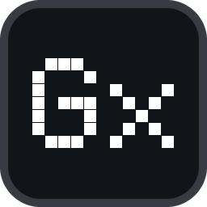
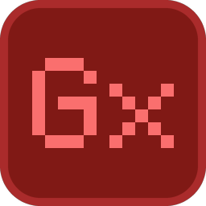

# Logo and icons

 

*New in v0.6.2.* One mark is used everywhere: a pixel **"Gx"** on the OLED's own dot grid, on a rounded tile. It was drawn from the
owner's two designs and has two states:

| State | Tile | Pixels | Meaning | Used for |
| --- | --- | --- | --- | --- |
| **Running** (black) | near-black `#111519`, grey rim `#383c42` | white | The application, running normally. | EXE file icon, tray icon while a base station is connected, both settings windows, sidebar and footer of the modern window, Flatpak icon, README banner |
| **No base station** (red) | dark red `#801915`, red rim `#aa2b2b` | salmon `#fa6f6e` | A reminder that the DAC is **not connected**, so the OLED is not being driven. | Tray icon (and only the tray icon) while no base station is found; the tooltip says it in words: *GxOled - no base station (DAC) connected* / *GxOled - DAC / baz istasyonu bağlı değil* |

The accent colour of the settings window and of the word *ADVANCED* in the banner is orange `#ff6b00`.

## The mark

The "G" is 5 × 7 cells, then one empty column, then a 5 × 5 "x" sitting on the same baseline: 11 × 7 cells in all (the cell patterns are
in `tools/make_branding.py` and, for the modern window, `MARK_G` / `MARK_X` in `gxoled_ui/src/chrome.rs`). Every raster size is drawn on
**whole pixels** — a cell is `round(size / 16)` px — so the dots stay razor sharp: the 16 px icon uses 1 px cells, the 32 px tray icon
2 px cells, the 128 px icon 8 px cells. The rim is left out up to 24 px and the hairline between the dots appears only on the big
black icons.

## Files

| File | What it is | Where it is used |
| --- | --- | --- |
| `assets/branding/gxoled-icon.svg` | Vector master, running state (1024 × 1024 grid) | Flatpak (`/app/share/icons/hicolor/scalable/apps/…`), any new size |
| `assets/branding/gxoled-icon-disconnected.svg` | Vector master, no-base-station state | reference |
| `gxoled_app/assets/gxoled.ico` | Windows icon, nine sizes (16 · 20 · 24 · 32 · 40 · 48 · 64 · 128 · 256 px, PNG-compressed) | file icon of `gxoled.exe` (`gxoled_app/build.rs`) and, as resource 1, the icon of the classic settings window and the classic profile editor |
| `gxoled_app/assets/gxoled.png` | 128 px icon | Flatpak 128 × 128 icon |
| `gxoled_app/assets/tray.png` | 32 px, running | tray icon (`include_bytes!` in `main.rs`) |
| `gxoled_app/assets/tray_error.png` | 32 px, no base station | tray icon while no DAC is connected |
| `docs/images/logo/gxoled-{512,256,128,64,32,16}.png` | PNG exports of the running state | documents, issues, anywhere a picture is needed |
| `docs/images/logo/gxoled-disconnected-{256,32}.png` | PNG exports of the red state | documents |
| `docs/images/banner.png` (1600 × 420) | README banner: icon, name, tagline, feature chips, an OLED illustration | top of `README.md` |
| `docs/images/social-preview.png` (1280 × 640) | GitHub *social preview* picture | upload it under the repository's **Settings → General → Social preview** (the API cannot do that; owner only) |
| `docs/images/gallery/01.png … 09.png` | The 3 × 3 README gallery | see [`images/gallery/README.md`](images/gallery/README.md) |

The sidebar and footer mark of the modern window is not a picture: `gxoled_ui::chrome::logo_mark` draws the same cells as SVG rectangles, so it
is sharp at any scale.

## Re-creating everything

```
python3 tools/make_branding.py        # needs Pillow (pip install pillow)
```

The script writes every file in the table above from one description of the mark and the fonts the application already embeds (Pixel
Operator for the lit-pixel lettering, Inter for the small text; licences in [`../THIRD_PARTY_NOTICES.md`](../THIRD_PARTY_NOTICES.md)).
It is safe to run again: a gallery slot that already holds a screenshot of yours is **not** touched, only empty slots and the generated
placeholders are rewritten. To change the colours or the mark, edit `NORMAL`, `DISCONNECTED`, `G` and `X` at the top of the script and
run it again; then update `MARK_G` / `MARK_X` in `chrome.rs` if the cell patterns changed and rebuild.

## Verification status

Generated and inspected as pictures on Linux; the colours and sizes in this page are read from the generator. **Not verified:** how the icons
look in the Windows tray, taskbar, title bars and Explorer on a real desktop (125 – 200 % scaling included), and the red tray icon on a real
unplugged base station.
